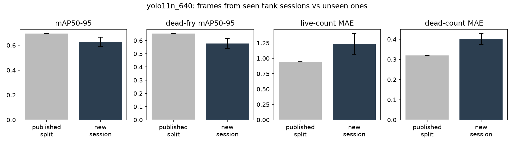
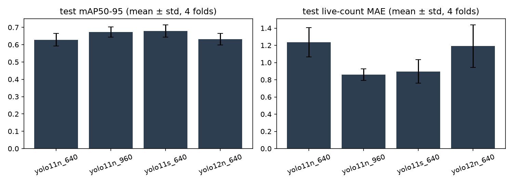
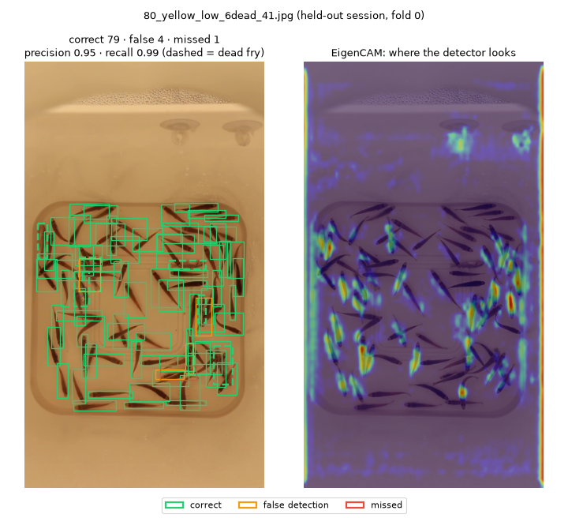

# Counting Fish Fry in a Tank the Model Has Never Seen

[](https://github.com/Rafi1523ewu/fish-fry-counting/actions/workflows/ci.yml)

Hatcheries count fry to set stocking density and watch for dead fry to catch disease early.
Object detectors trained on the public Fish Fry Dataset report about 0.97 mAP50, but that
number is measured on frames from the same tank sessions the model was trained on. This
project asks the question a farm actually faces: **on a new tank, how accurately does a
detector count live fry, count dead fry, and estimate mortality?**

## The dataset, and why its split overstates accuracy

[Fish Fry Dataset (FFD)](https://data.mendeley.com/datasets/y52ffd3xdc) (Zhai, Xu & Wu, Mendeley
Data, 2024, CC BY 4.0): 1,101 frames (1080×1920) of largemouth bass fry with 51,119 live and 3,586
dead fry annotated.

The file names encode how each frame was filmed. `60_yellow_high_5dead_12.jpg` is frame 12 of
the session with 60 fry, a yellow background, level "high" (a recording condition the dataset
does not explain), and 5 dead fry placed in the tank. That gives **16 sessions** (4 densities ×
2 backgrounds × 2 levels) of 33–50 frames each.

The dataset's own train / validation / test split (656 / 220 / 225 frames) draws frames from
**all 16 sessions in every part**. Neighbouring frames of one session are nearly identical, so a
test frame almost always has a twin in training. Scores on that split measure recall of a seen
tank, not generalisation to a new one.

## Protocol

- **`published`**: the dataset's split, used only to reproduce the original results and measure
  how much the leak inflates them.
- **`session_cv` (primary)**: 4-fold cross-validation over whole sessions. Each fold tests four
  sessions the model never saw, one per density, arranged so every background/level combination
  appears once per fold and every session is tested exactly once:

  | fold | 20 fry | 40 fry | 60 fry | 80 fry |
  |---|---|---|---|---|
  | 0 | white-high | white-low | yellow-high | yellow-low |
  | 1 | white-low | yellow-high | yellow-low | white-high |
  | 2 | yellow-high | yellow-low | white-high | white-low |
  | 3 | yellow-low | white-high | white-low | yellow-high |

  Two further whole sessions per fold form the validation set (early stopping and the counting
  threshold); the remaining ten are for training.
- **Models**, fixed in advance and selected by validation mAP50-95 only: YOLO11n at 640 px (the
  original setting), YOLO11n at 960 px (the fry are small), YOLO11s at 640 px and YOLO12n at
  640 px, each for 50 epochs. The grid is sized to fit one weekly Kaggle GPU quota.
- **Metrics**: mAP50 and mAP50-95 per class; per-frame live-count and dead-count error;
  mortality-rate error in percentage points; dead-fry alarm recall (frames with a dead fry
  where at least one is found); session-level count error (median over a session's frames); all
  broken down by stocking density. The confidence threshold for counting is chosen on the
  validation sessions, then frozen.

## Results

The original coursework reported, on the published split:

| Model | test mAP50 | test mAP50-95 | dead-fry mAP50-95 |
|---|---|---|---|
| YOLO12n, 640 px, 50 epochs | 0.968 | 0.689 | 0.644 |
| YOLO11n, 640 px, 50 epochs | 0.965 | 0.681 | 0.632 |

Re-run here on the published split, YOLO11n at 640 px reproduces it (test mAP50 0.967,
mAP50-95 0.695), which confirms this pipeline matches the original.

### How much the leak inflates the scores

Same model and settings (YOLO11n, 640 px), tested on frames from **seen** sessions (published
split) versus whole **unseen** sessions (session CV, mean ± std over 4 folds):

| | published split | unseen sessions | change |
|---|---|---|---|
| mAP50 | 0.967 | 0.950 ± 0.008 | −0.017 |
| mAP50-95 | 0.695 | 0.629 ± 0.037 | **−0.066** |
| dead-fry mAP50-95 | 0.653 | 0.578 ± 0.038 | −0.075 |
| live-count error (fry per frame) | 0.95 | 1.24 ± 0.17 | **+30%** |
| dead-count error (fry per frame) | 0.32 | 0.40 ± 0.03 | +26% |



mAP50 barely moves, which is why the leak is easy to miss. The stricter mAP50-95 drops by 0.066
and counting error grows by about a third: the published split rewards a model for having seen
almost the same frame in training.

### Which model, on unseen sessions

All four configurations under session CV (mean ± std over 4 folds). The model is chosen by
**validation** mAP50-95; test numbers played no part.

| Config | val mAP50-95 | test mAP50 | test mAP50-95 | live-count error | dead-count error | mortality error (pp) |
|---|---|---|---|---|---|---|
| YOLO11n, 640 px | 0.672 | 0.950 | 0.629 ± 0.037 | 1.24 ± 0.17 | 0.40 | 0.70 |
| **YOLO11n, 960 px** (selected) | **0.715** | 0.969 | 0.673 ± 0.030 | **0.86 ± 0.07** | **0.31** | **0.54** |
| YOLO11s, 640 px | 0.714 | 0.970 | 0.679 ± 0.036 | 0.90 ± 0.14 | 0.33 | 0.57 |
| YOLO12n, 640 px | 0.675 | 0.951 | 0.631 ± 0.034 | 1.19 ± 0.25 | 0.48 | 0.82 |



Resolution matters more than model size: the nano model at 960 px matches the 3.5× larger
small model at 640 px, and both beat 640 px nano by about 30% on live-count error. YOLO12n is
no better than YOLO11n. The validation pick (960 px nano) edges the small model by 0.001
validation mAP50-95; on test the two are within one standard deviation.

### Counting for a farm (selected model, 1,101 held-out frames)

| Fry in tank | frames | live-count error | exact live count | dead-count error | exact dead count | dead-fry alarm recall |
|---|---|---|---|---|---|---|
| 20 | 280 | 0.07 | 93% | 0.02 | 98% | 98.9% |
| 40 | 266 | 0.51 | 56% | 0.16 | 85% | 100% |
| 60 | 278 | 1.17 | 31% | 0.45 | 61% | 100% |
| 80 | 277 | 1.69 | 17% | 0.59 | 51% | 100% |
| all | 1,101 | 0.86 (1.5%) | 49% | 0.31 | 74% | 99.7% |

- **Live fry**: off by under one fry per frame on average (1.5%), and unbiased (mean signed
  error within ±0.26 fry at every density). Taking the median over a session's frames, as a
  farmer reading a short clip would, the count is off by 0.38 fry on average.
- **Dead fry**: a frame that contains a dead fry is flagged 99.7% of the time, and the estimated
  mortality rate is within 0.54 percentage points of the truth.
- **Crowding is the limit**: at 20 fry, 93% of frames are counted exactly; at 80 fry, 17%.
  Error grows roughly linearly with density, as overlapping fry merge into one detection.

Per-run metrics are in [`results/runs.csv`](results/runs.csv), fold averages in
[`results/summary.csv`](results/summary.csv), and the per-density table in
[`results/by_density.json`](results/by_density.json). The full run (17 trainings) took 2.2 hours on
two Kaggle T4 GPUs.

### What the detector gets right, and where it looks

`fishfry explain` takes a trained model and one frame from each of a fold's held-out sessions
(the middle frame, not hand-picked). It shows every box checked against the annotations (green
correct, orange false detection, red missed; dashed = dead fry; a dead fry labelled live counts
as wrong) and an **EigenCAM** heat map of where the detector looks. Grad-CAM needs a single class
score to differentiate, which an object detector does not have; EigenCAM (Muhammad & Yeasin,
2020) instead takes the first principal component of the feature map the detection head reads
for its smallest objects, so it needs no gradients.

Selected model (YOLO11n, 960 px), fold 0, all four sessions unseen in training:

| Session | correct | false | missed | precision | recall |
|---|---|---|---|---|---|
| 20 fry, white, high | 20 | 0 | 0 | 1.00 | 1.00 |
| 40 fry, white, low | 40 | 0 | 0 | 1.00 | 1.00 |
| 60 fry, yellow, high | 57 | 1 | 2 | 0.98 | 0.97 |
| 80 fry, yellow, low | 79 | 4 | 1 | 0.95 | 0.99 |



The heat map sits on the fry bodies, and the mistakes are where fry overlap: a cluster read as
one fish too many, or two touching fry read as one. The map also lights up the suction cups
outside the tank and the image border, which no detection uses. Figures for all four sessions are
in [`results/explain/`](results/explain/).

## What was tried and dropped

The original coursework also started a STAC-style semi-supervised teacher–student model (never
run) and BYOL self-supervised pre-training of the backbone, whose loss collapsed to a constant
(−0.9999) and gave 0.017 mAP50. Neither is part of this repository.

## Limitations

- One species, one laboratory set-up and 16 sessions: four test sessions per fold make the fold
  standard deviations large relative to the differences between the better models.
- No session has zero dead fry, so the dead-fry false-alarm rate cannot be measured here.
- The "level" (high / low) in the file names is not documented by the dataset authors; it is
  used only to balance the folds.

## Usage

```bash
git clone https://github.com/Rafi1523ewu/fish-fry-counting.git
cd fish-fry-counting
pip install -e ".[dev]"

fishfry prepare --out data/ffd            # downloads FFD.zip from Mendeley and checks its SHA-256
fishfry grid --data data/ffd --runs runs  # trains and evaluates every job; finished jobs are skipped
fishfry summarize --runs runs --out results
fishfry explain --weights runs/session_cv/yolo11n_960/fold0/train/weights/best.pt --fold 0  # per-frame figures
```

`fishfry prepare --zip path/to/FFD.zip` uses a local copy instead. On a machine with several
GPUs, `fishfry grid --gpus N` runs one shard per GPU. Every setting lives in
[`configs/default.yaml`](configs/default.yaml).

## Project structure

```
configs/default.yaml     data checksum, session Latin square, model grid, counting thresholds
src/fishfry/data.py      download, unpack, index frames by session, verify totals
src/fishfry/splits.py    published and session-held-out splits, Ultralytics dataset folders
src/fishfry/train.py     train one configuration, evaluate detection and counting
src/fishfry/counting.py  live/dead counts, threshold chosen on validation, farm metrics
src/fishfry/grid.py      resumable grid, sharded across GPUs; summary tables
src/fishfry/plots.py     figures for this README
src/fishfry/explain.py   correct / missed / false boxes per frame, EigenCAM heat maps
kaggle/run.ipynb         the full run on a Kaggle GPU notebook
results/                 run and fold tables, per-density counting, figures
tests/                   data, split, counting and grid tests on a synthetic dataset
```

## Testing

```bash
pytest -q
```

The tests build a miniature dataset with the real session structure and check that the
published split leaks every session, that session folds never share a session and test each
one exactly once, that counting metrics are exact on known predictions, and that the grid
shards and resumes correctly. They run on CPU without downloading any model weights.

## License

Code: MIT. Dataset: CC BY 4.0, by Zhai, Xu & Wu (2024); cite
[doi:10.17632/y52ffd3xdc.1](https://doi.org/10.17632/y52ffd3xdc.1).
